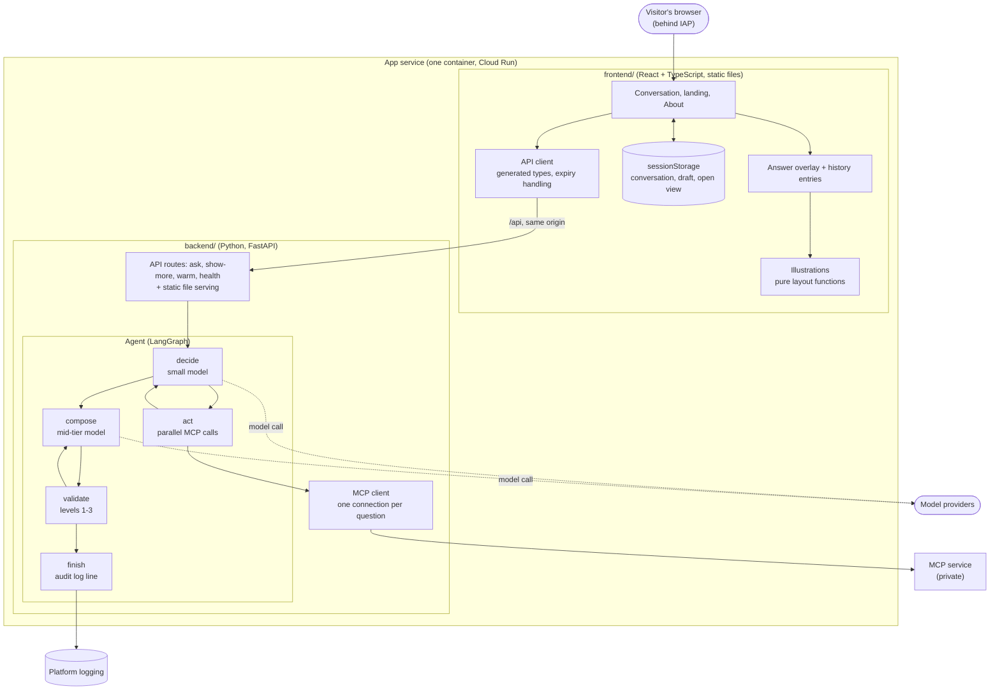

# App repo: C4 component view (level 3)

Part of the [main architecture document](../space-agent-architecture.md). Decisions are in [adr/](adr/).

## Inside the app container

## Notes
- The deadline is created in `api` when the request arrives and travels in the agent state ([ADR 0012](adr/0012-bounded-loops-deadline-and-cost-guards.md)).
- The backend returns facts and words; `illus` draws from raw data ([ADR 0009](adr/0009-react-and-python-api-in-one-container.md), [ADR 0011](adr/0011-one-api-contract-with-generated-types.md)).
- A decline with no tool calls goes from `decide` straight to `finish` (not drawn).
- The eval job (command line, not part of the service) runs the same agent code with fake or real tools ([ADR 0005](adr/0005-evals-on-demand-with-an-independent-judge.md)).
