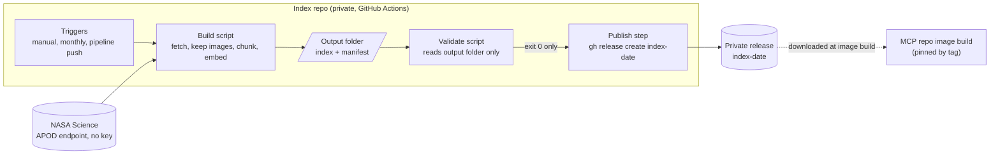

# Index repo: C4 component view (level 3)

Part of the [main architecture document](../space-agent-architecture.md). Decision records: [ADR 0001](adr/0001-private-index-repo-with-manifest-and-release.md), [ADR 0002](adr/0002-multi-qa-minilm-embedding-model.md), [ADR 0003](adr/0003-chunk-only-long-entries.md), [ADR 0004](adr/0004-archive-source-nasa-science-endpoint.md), [ADR 0005](adr/0005-builder-fetch-rules-and-defences.md).

Notes:
- Build and validate share no code on purpose; both check for placeholder entries.
- Every run rebuilds the whole window; the build fails loudly on unexpected source data.
- The release is private and is read only by the MCP repo's image build.
