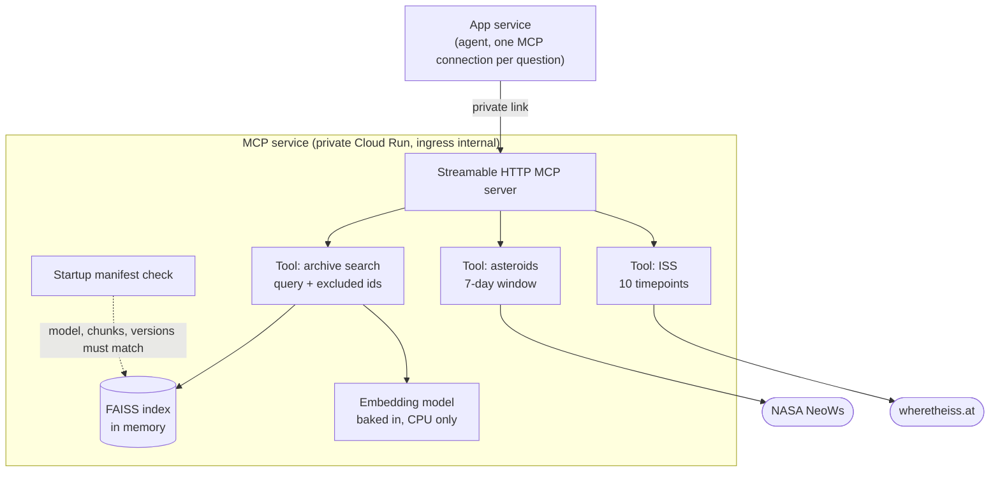

# MCP repo: C4 component view (level 3)

Part of the [main architecture document](../space-agent-architecture.md). Decisions: [ADR 0001](adr/0001-http-mcp-server-on-a-private-link.md), [ADR 0002](adr/0002-index-and-model-baked-into-image.md), [ADR 0003](adr/0003-tools-return-data-only.md).

Build time (not shown above): the Dockerfile reads the pin file, downloads the index release with a build secret, verifies its checksum, runs the manifest check and downloads the model weights.
