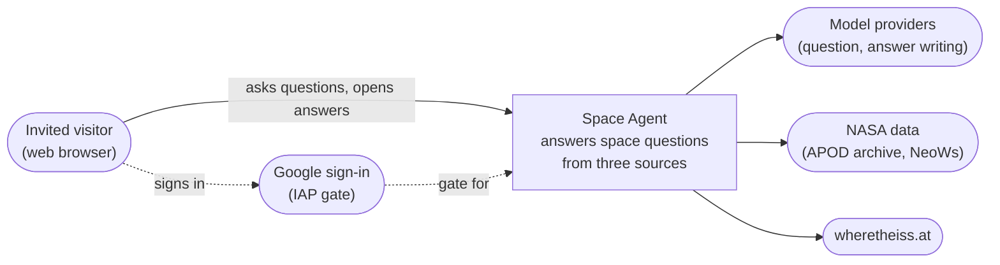
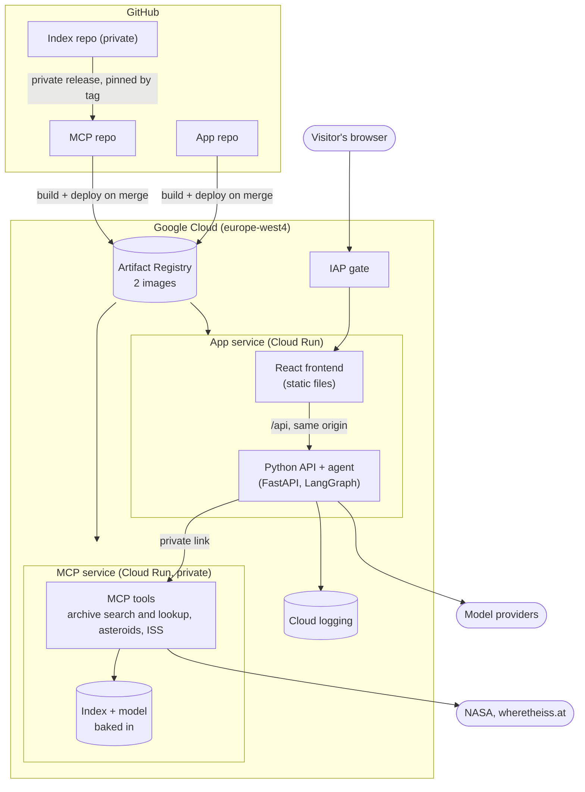
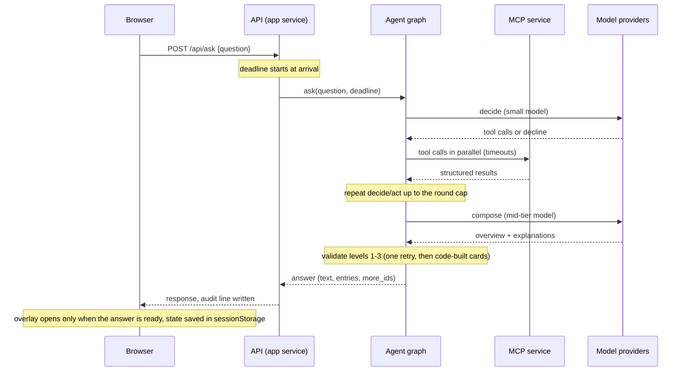

# Space Agent: Architecture

A lean [arc42](https://arc42.org)-style description of the Space-Themed AI Agent, with [C4](https://c4model.com) diagrams (Mermaid) and decision records ([ADRs](#9-architecture-decisions)) kept per repository. Sections that would have been empty are left out.

Status: written 2026-11-01 from the architecture working notes. Product scope lives in the product requirements, vision brief and test plan, not here.

## 1. Introduction and goals

**What it is.** A web app where a visitor asks natural-language questions about space and gets sourced answers from three data sources: the APOD archive (historical and educational questions, with images), near-Earth asteroid approach data for the next 7 days (one illustration of every matching asteroid), and the ISS's current position and projected 90-minute path (one illustration).

**What the architecture must deliver**

| Goal | What it means here |
|---|---|
| Grounded answers | Facts are copied by code from tool results; the model writes only the words; claims are checked before they are shown ([ADR 0004](app/adr/0004-code-owns-facts-model-owns-words.md)). |
| Demonstrate current AI engineering | RAG, MCP tool-calling, an agent loop with guards, an eval layer, AI-assisted development with review. |
| Low, bounded cost | Scale to zero, one small instance per service, layered guards against runaway spend ([ADR 0012](app/adr/0012-bounded-loops-deadline-and-cost-guards.md)). |
| Live but access-gated | Only invited people can open it; the restriction is cloud configuration, not code ([ADR 0007](app/adr/0007-access-gate-with-cloud-run-iap.md)). |
| Portable | Moving to another host changes cloud settings and one pipeline step, not application code. |

## 2. Constraints

- No user accounts, no cookies for conversation loading, no database ([ADR 0006](app/adr/0006-no-database.md)).
- Each question is answered on its own; the only continuation is "Show more" on archive results ([ADR 0003](app/adr/0003-stateless-agent-each-question-alone.md), [ADR 0013](app/adr/0013-show-more-by-reserved-ids.md)).
- The interface must work at phone width.
- The archive index lives in a private repository and is baked only into a private image.
- Hosting: Google Cloud Run in europe-west4, scale to zero, one environment.
- Source control and delivery: GitHub and GitHub Actions; three repositories ([ADR 0001](app/adr/0001-three-repos-two-services.md)).

## 3. Context and scope (C4 level 1)

External interfaces: Google account sign-in (access gate), two model providers (one for the agent, a different one as the judge in evals), NASA's APOD archive (read from the NASA Science site) and NeoWs data, and the ISS position source wheretheiss.at.

## 4. Solution strategy

1. **Code owns facts, the model owns words.** Validation runs at three levels before an answer is shown; a failed answer falls back to code-built cards ([ADR 0004](app/adr/0004-code-owns-facts-model-owns-words.md)).
2. **A small, bounded graph.** LangGraph provides nodes, edges and state; every node body is plain Python ([ADR 0002](app/adr/0002-langgraph-skeleton-with-plain-python-nodes.md)).
3. **Stateless services; state in the browser.** The conversation lives in `sessionStorage` ([ADR 0010](app/adr/0010-conversation-held-in-the-browser.md)).
4. **Privacy by network, gate by identity proxy.** The data tools are on a private link; the app sits behind IAP ([MCP ADR 0001](mcp/adr/0001-http-mcp-server-on-a-private-link.md), [ADR 0007](app/adr/0007-access-gate-with-cloud-run-iap.md)).
5. **Immutable data in the image.** The embedding model and the validated index are baked into the MCP image ([MCP ADR 0002](mcp/adr/0002-index-and-model-baked-into-image.md)).
6. **One contract, generated types.** The backend defines the API once; the frontend types are generated and checked in CI ([ADR 0011](app/adr/0011-one-api-contract-with-generated-types.md)).
7. **Assume things go wrong.** Deadlines, per-call timeouts, loop caps and spend limits are designed in ([ADR 0012](app/adr/0012-bounded-loops-deadline-and-cost-guards.md)).

## 5. Building blocks

### Level 2: containers

| Building block | Responsibility | Detail |
|---|---|---|
| Frontend (`frontend/` in app repo) | Conversation, landing, About, answer overlay, history entries, illustrations drawn from data, saved browser state | [App components](app/c4-components.md) |
| Backend (`backend/` in app repo) | API, agent graph, validation, audit log line, serving the built frontend | [App components](app/c4-components.md) |
| MCP service (MCP repo) | Four data tools (archive search, archive lookup, asteroids, ISS), in-memory index, embedding model | [MCP components](mcp/c4-components.md) |
| Index pipeline (index repo) | Build, validate and publish the index release | [Index components](index/c4-components.md) |

## 6. Runtime view

### Asking a question

### Other flows

- **Show more.** The first archive search keeps more entries than it shows and the answer carries the ids of the reserved ones in `more_ids`. The browser sends the next ids, at most 3. The agent skips decide: lookup by id, compose, validate. New entries come back in the same `entries` field ([ADR 0013](app/adr/0013-show-more-by-reserved-ids.md), [MCP ADR 0004](mcp/adr/0004-archive-search-and-lookup-by-id.md)).
- **Decline.** Out-of-scope or "relies on earlier answer" questions get an agent-written message, checked by a guard, with a fixed fallback. No overlay opens.
- **Landing.** The page calls a warm-up endpoint so the MCP service wakes while the visitor reads.
- **Refresh or expired sign-in.** The page reloads, passes the quick Google sign-in if needed, restores the saved conversation, and puts an unanswered question back in the input ([ADR 0010](app/adr/0010-conversation-held-in-the-browser.md)).
- **Timeout.** The agent's own deadline ends the request gracefully; Cloud Run's 120 s limit is only a backstop.

## 7. Deployment view

- **Services.** App service: one container (Node build stage, Python runtime) behind IAP, reaching the MCP service over Direct VPC egress limited to private ranges. MCP service: internal ingress only, no login of its own, reachable through a private DNS zone for `run.app.` ([MCP ADR 0001](mcp/adr/0001-http-mcp-server-on-a-private-link.md)).
- **One-time cloud settings** (kept in a runbook, not in the pipeline): ingress, VPC egress, Private Google Access, private DNS, IAP and OAuth client, workload identity pool and provider, service accounts, registry and cleanup policy, spend limits, and instance caps (max 1 instance each, small size).
- **Pipeline.** Pull requests run lint, types, deterministic tests, secret scan and the image build. On merge to `main`, GitHub Actions builds the image, tags it with the commit, pushes it to Artifact Registry and swaps the image of the service ([ADR 0008](app/adr/0008-registry-login-and-deploy-flow.md)). Rollback is a redeploy of an earlier commit tag. A separate review-only workflow comments on pull requests after CI passes.
- **Measured in the spikes.** Cold start to a usable page is about 3 s or less for the React app (about 12.55 s on the earlier Streamlit prototype); the MCP service takes about 4.3 s cold. Both were rough measurements; the real app is to be re-measured.

## 8. Cross-cutting concepts

- **Configuration.** `MAX_ROUNDS` (start 3), `MAX_COMPOSE_RETURNS` (1), per-node model names, timeouts, token caps, the agent deadline (about 90 s), the MCP service address. No infrastructure restriction lives in code.
- **Secrets.** GitHub secrets for CI; the host's secret store at runtime; separate keys for the review workflow, the app and the NASA service. No secret in an image, a layer or a public document.
- **Observability.** One structured JSON line per question from the finish step to the platform log: request id, time, call kind, question text (length-capped), outcome and decline reason, deadline-hit flag, rounds, compose returns, failed validation checks, tool calls (name, status, duration), models (name, tokens, duration), totals (duration, estimated cost), and returned entry ids only (no archive text).
- **Testing.** Deterministic tests with fake tools and fake models (including a tool and a model that never answer, and oversized or adversarial strings). Layout maths of the illustrations as pure, unit-tested functions. Manual checks for illustration layout and usability, including a real phone.
- **Evals.** On demand, outside CI: code checks plus a judge model from the other provider; used to compare models per node, round caps and prompts ([ADR 0005](app/adr/0005-evals-on-demand-with-an-independent-judge.md)).
- **Cost control.** Layered guards in [ADR 0012](app/adr/0012-bounded-loops-deadline-and-cost-guards.md), including a spend limit on the model provider's workspace and an ingress setting that acts as a kill switch.
- **AI-assisted development.** An `AGENTS.md` file in each repo carries the project rules; Claude Code is used locally by the developer, who commits; a separate review-only action comments on pull requests. Code rules from [ADR 0012](app/adr/0012-bounded-loops-deadline-and-cost-guards.md) (no unbounded loops, no unguarded regexes on long text, length caps) are part of the review rules.

## 9. Architecture decisions

Numbered in the order decided, per repo; never renumbered. A superseded decision stays with its status. Decisions that span repos live in the app repo.

| Repo | ADR | Decision | Theme |
|---|---|---|---|
| app | [0001](app/adr/0001-three-repos-two-services.md) | Three repositories, two services | Structure |
| app | [0002](app/adr/0002-langgraph-skeleton-with-plain-python-nodes.md) | LangGraph skeleton with plain Python nodes | Agent |
| app | [0003](app/adr/0003-stateless-agent-each-question-alone.md) | Stateless agent; each question alone (Show more part superseded by 0013) | Agent |
| app | [0004](app/adr/0004-code-owns-facts-model-owns-words.md) | Code owns facts, the model owns words | Agent |
| app | [0005](app/adr/0005-evals-on-demand-with-an-independent-judge.md) | Evals on demand with an independent judge | Quality |
| app | [0006](app/adr/0006-no-database.md) | No database | Structure |
| app | [0007](app/adr/0007-access-gate-with-cloud-run-iap.md) | Access gate with Cloud Run IAP | Hosting |
| app | [0008](app/adr/0008-registry-login-and-deploy-flow.md) | Artifact Registry, Workload Identity Federation, deploy on merge | Delivery |
| app | [0009](app/adr/0009-react-and-python-api-in-one-container.md) | React and Python API in one container (supersedes Streamlit) | Frontend |
| app | [0010](app/adr/0010-conversation-held-in-the-browser.md) | Conversation held in the browser | Frontend |
| app | [0011](app/adr/0011-one-api-contract-with-generated-types.md) | One API contract, generated types (Show more fields superseded by 0013) | Frontend |
| app | [0012](app/adr/0012-bounded-loops-deadline-and-cost-guards.md) | Bounded loops, deadline, cost guards | Safety and cost |
| app | [0013](app/adr/0013-show-more-by-reserved-ids.md) | Show more fetches reserved entries by id | Agent |
| mcp | [0001](mcp/adr/0001-http-mcp-server-on-a-private-link.md) | HTTP MCP server on a private link | Hosting |
| mcp | [0002](mcp/adr/0002-index-and-model-baked-into-image.md) | Index and model baked into the image | Delivery |
| mcp | [0003](mcp/adr/0003-tools-return-data-only.md) | Tools return data only (exclusion list and extra-result rule superseded by 0004) | Agent |
| mcp | [0004](mcp/adr/0004-archive-search-and-lookup-by-id.md) | Archive search returns a ranked list; lookup tool by id | Agent |
| index | [0001](index/adr/0001-private-index-repo-with-manifest-and-release.md) | Private index repo, manifest, validated release | Delivery |
| index | [0002](index/adr/0002-multi-qa-minilm-embedding-model.md) | Embedding model `multi-qa-MiniLM-L6-cos-v1` | Retrieval |
| index | [0003](index/adr/0003-chunk-only-long-entries.md) | Split only long entries into overlapping chunks | Retrieval |
| index | [0004](index/adr/0004-archive-source-nasa-science-endpoint.md) | Archive source: NASA Science `apod-basic` endpoint, no key | Data source |
| index | [0005](index/adr/0005-builder-fetch-rules-and-defences.md) | Builder: full rebuild, paged fetch, images only, fail loudly | Data source |

## 10. Quality requirements

| Quality | Scenario | How the design addresses it |
|---|---|---|
| Accuracy | A visitor reads a distance or date in an answer | The value was copied by code from the tool result and checked against it ([ADR 0004](app/adr/0004-code-owns-facts-model-owns-words.md)). |
| Honest scope | A question the data cannot answer | A plain, agent-written explanation with a guard; no improvised answer. |
| Responsiveness | First visit after idle | About 3 s to a usable page plus a warm-up call; answers bounded by the 90 s deadline. |
| Resilience | Refresh, expired sign-in, idle shutdown | State is restored from the browser; services hold no conversation. |
| Cost | A hung call or a loop | Timeouts, caps, one small instance, spend limit, kill switch. |
| Phone use | A visitor on a phone-width screen | The whole illustration is reachable by scrolling; the overlay is a normal responsive view. |

## 11. Risks, technical debt and open items

**Risks to carry**
- A never-yielding loop in our own code would burn CPU until the instance ends; bounded by the single small instance ([ADR 0012](app/adr/0012-bounded-loops-deadline-and-cost-guards.md)).
- The real IAP session lifetime and the exact response at expiry are unconfirmed; both forms are handled.
- Abandoned-tab billing did not appear in the React spike but is still to be confirmed with the next billing report.

**Open items**
- Where eval results are stored without a database, how they are shown, and what protects that view.
- The ISS illustration specification; asteroid illustration details found in the spike (tick omission rule, label truncation, overlap guarantee, panel clipping).
- Per-node model assignment (starts as a small model for decide and a mid-tier model for compose; the evals tune it).
- The relevance cut-off that decides which archive matches are kept, and the number of entries held in reserve for Show more.
- Whether the archive explanation text is fetched live instead of baked into the index.
- Model SDK timeout and retry options; provider billing behaviour on dropped requests.
- Image size and build time of the MCP image; re-measured cold starts with the real app; a real phone and Safari check.
- A runbook for the one-time cloud settings, written when the first pipeline is built.

## 12. Glossary

- **APOD:** NASA's Astronomy Picture of the Day archive.
- **ADR:** architecture decision record, one short file per important decision.
- **C4:** a way to draw a system at several zoom levels (context, containers, components).
- **IAP:** Identity-Aware Proxy, the Google sign-in gate in front of the app.
- **MCP:** Model Context Protocol, the standard the agent uses to call the data tools.
- **NeoWs:** NASA's near-Earth object web service.
- **Direct VPC egress:** how the app service sends traffic into the private network.
- **Deadline:** the absolute time by which a request must finish, carried through the agent.
