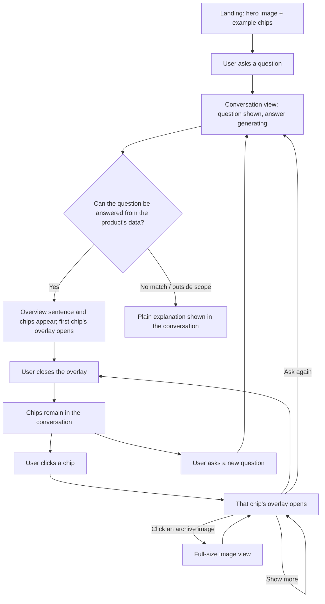

# Discover the Cosmos — UX Requirements

Version 1.2

## 1. Purpose & Background

Discover the Cosmos is a public web application that lets anyone ask natural-language questions about space and get sourced, trustworthy answers. It draws on three data sources: NASA's Astronomy Picture of the Day (APOD) archive for historical and educational questions, near-Earth object approach data for asteroid questions, and the current position of the International Space Station (ISS) for real-time location questions.

## 2. Target Users

A general member of the public with casual curiosity about space — no astronomy background assumed, no account, no setup. The product must be usable by someone who has never seen it before, with no instructions beyond what's on screen.

## 3. Scope

**In scope:**
- Asking natural-language questions about space
- Answers from the APOD archive (still images), from the near-Earth asteroids of the next 7 days, and from the ISS's current position and its next 90 minutes
- One question bringing several kinds of answer. Each kind opens in its own full-screen overlay and leaves its own chip in the conversation
- Loading more archive pictures with a "Show more" button
- Reopening any earlier answer from its chip, and asking the same asteroid or ISS question again with an "Ask again" button
- A conversation and its chips that stay for as long as the browser tab is open, including after a reload
- Graceful handling of questions the product's data cannot answer

**Out of scope for this release:**
- User accounts, login, or personalization
- History that outlives the browser tab or is shared between tabs or devices
- Hosting and access-control decisions — these are deployment considerations layered around the product, not addressed by this document
- Follow-up questions that rely on a previous answer. Each question is answered on its own, with no knowledge of earlier questions or answers
- Questions to the agent about a specific asteroid, a comparison between asteroids, or a specific point along the ISS's projected path. These are treated like any other out-of-scope question. (Tapping a circle or a dot inside an illustration is supported; this exclusion is about asking the agent.)

## 4. Screen Inventory

| Screen | Description |
|---|---|
| Landing | First screen a visitor sees. A fixed hero image from the archive with a dark overlay so the text stays readable, the title, a one-line product description, four example-question chips (two archive, one asteroid, one ISS), a single question input, and a small About link. |
| Conversation | The main view. The landing screen transitions into this on the first question; it is not a separate page. Each answer shows one overview sentence and its chips. |
| Answer overlay | A full-screen view of one kind of answer: archive, asteroids or ISS. It shows a "Your question" line and a close button. For the archive, the image is on the left and the text on the right on desktop, and the image is on top on phones and in windows narrower than about 900 px. There are arrows with an "n of N" counter, and the image is fitted on a blurred backdrop and never cropped. The asteroid and ISS overlays show their illustration with an explanation, a legend and an "Ask again" button. |
| Full-size image view | Opens when the user clicks an archive image. Esc closes it, and there is an easy way back from zoom to fit-to-screen. |
| History chip | A small, reopenable item in the conversation. Each answer leaves up to three, one per kind, labelled for example "Archive · 3 pictures", "Asteroids · 2–9 Nov" and "ISS · 09:14". Each chip opens its own overlay. |
| About | Static info: what the product can and can't answer, that each question is answered on its own, the fuller "illustrative only" explanation of the illustrations, and NASA/APOD attribution. |

## 5. User Flow

In plain terms: the landing screen collapses into a normal conversation on the first question. When an answer is ready, its overview sentence and all of its chips appear together, and the first chip's overlay opens automatically in a fixed order: archive, asteroids, ISS. Overlays never switch on their own; the user closes one and opens another from its chip. Every further question starts the same flow again and is answered on its own.

## 6. Screen States

| Screen | Empty | Loading | Success | Error / No results |
|---|---|---|---|---|
| Landing | Default hero image and chips shown on first load | N/A | N/A | N/A |
| Conversation | N/A (never empty once the first question is asked) | "Thinking…" indicator, no overlay yet | Overview sentence and chips appear | Same as the no-match case below |
| Answer overlay | N/A | Not shown until the full answer is ready | Shows one kind of answer, as described in section 7. An ISS snapshot older than about 10 minutes shows a warning. | If nothing matches or the question falls outside the product's data, no overlay opens and no chip is left; the conversation shows a plain explanation instead. If a week has no near-Earth asteroids in NASA's data, no asteroid overlay opens; the conversation says so plainly. |
| Full-size image view | N/A | N/A | The picture at fit-to-screen, with zoom | N/A |

## 7. Requirements

### 7.1 Answers and chips

- An answer is one overview sentence in the conversation plus up to three chips: archive, asteroids and ISS. They appear together once the full answer is ready, never while it is still being generated.
- Each chip opens its own overlay, and an overlay never mixes kinds. The first chip opens automatically in the order archive, asteroids, ISS, with no transitions between overlays.
- Closing an overlay never loses anything. The chip stays, and the user can reopen it at any time while the tab is open.
- An overlay carries the explanation for its own kind. The overview sentence in the conversation ties the kinds together.
- The conversation and its chips stay for as long as the tab is open, including after a reload, and are not shared with other tabs. A new tab starts empty.

### 7.2 Archive

- A request returns up to three pictures, shown one at a time with arrows and an "n of N" counter. Each shows the image, its title, its date, a credit line, and a link to the original NASA entry. NASA's own explanation text is not copied; the link serves as the verifiable source.
- Only still images are included, so every archive picture has an image. The image is fitted and never cropped, and clicking it opens the full-size view.
- The "Show more" button lives in the archive overlay, including in earlier archive chips the user reopens. It loads further unseen pictures without adding a question to the conversation. The new pictures join the same chip, so its label and counter grow. The button is no longer shown once all matches have been shown.

### 7.3 Asteroids

- The overlay shows every near-Earth asteroid for the next 7 days in one illustration, with the window dates and the asteroid count. Earth is at the left, distance runs left to right on a compressed scale, and height has no meaning. Potentially hazardous asteroids have an extra ring, and the drawing can be dragged to reach every asteroid.
- Hovering over or tapping an asteroid opens a panel with its hazard tag, name, closest-approach date (for example "Passes Wed 4 Nov"), distance in lunar distances, and size range with a size name.
- The legend says that "potentially hazardous" is NASA's classification, not a prediction of impact.
- In a very crowded week some circles may overlap, but none is hidden.
- An "Ask again" button closes the overlay and sends the asteroid example question as a new message. It shows no stale warning, because the window dates are shown.

### 7.4 ISS

- The overlay shows the ISS's position at the moment of the question, labelled with the snapshot time and shown as text, together with its altitude, speed, and whether it is in daylight or darkness.
- Dots mark the next 90 minutes every 10 minutes, each shaded day or night. Tapping a dot opens a small panel with its relative time (for example "+30 min"), its actual time (for example "16:22") and its daylight status (for example "In daylight").
- The Moon is drawn for scale, and the orbit height is noted as exaggerated.
- A snapshot older than about 10 minutes shows a warning, with labels like "6 hours ago".
- An "Ask again" button closes the overlay and sends the ISS example question as a new message, which produces a new chip. A snapshot never refreshes in place and never stacks with another.

### 7.5 Questions and answers

- Every answer is limited to what the product's own data sources contain: the archive, near-Earth object approach data, and ISS position and path data. Anything else, including general trivia about asteroids, the ISS crew or its history, receives a plain explanation of what the product can answer, never an improvised answer or a generic error.
- Every question is answered on its own, with no knowledge of earlier questions or answers. A question that cannot be understood without an earlier answer (for example, "tell me more about that one") receives a plain explanation that each question is answered on its own, a request to include what is meant, such as a picture's title or an object's name, and a pointer to the earlier answer, which can be reopened from its chip. The agent never guesses what the user means and never asks a clarifying question. A question that names its subject in full is an ordinary question, even if it was answered before.
- Questions about a specific asteroid, a comparison between asteroids, or a specific point along the ISS's projected path are out of scope and receive the same plain explanation.
- When one question combines a part the product can answer with a part it cannot, the agent answers the part it can and explains the part it cannot.
- Asking again with an "Ask again" button is an ordinary question: the example question appears in the conversation as the user's message.

## 8. Success Criteria

- Answers are accurate and grounded in the product's own data sources, never presented as opinion or general knowledge.
- Every answer's origin (archive entry, asteroid data, or ISS data) is visible to the user.
- A first-time visitor can use the product with no instructions, aided by the example-question chips.
- Out-of-scope questions and no-result cases are handled as normal, expected outcomes, not as errors.
- The interface remains usable on a phone-width screen.

## 9. Constraints & Assumptions

- No user accounts or login.
- Built on real, publicly available NASA and space data: the APOD archive, near-Earth object approach data, and ISS position and path data.
- Cost limits and the hosting/access model are undecided and intentionally excluded from this document.

## 10. Future Considerations

- User accounts and personalization based on accumulated history.
- History that outlives the browser tab or is shared between tabs or devices.
- Follow-up questions that build on earlier answers, with the agent remembering the conversation.
- Expanding beyond the initial three data sources (APOD archive, near-Earth object data, ISS position and path) to other space data.
- More granular interaction with asteroid and ISS data through questions to the agent — such as asking about a specific asteroid, comparing asteroids, or asking about a specific point along the ISS's projected path.
